# practica-1.4-daw-26-27

### Paso 1: Configuración inicial del entorno
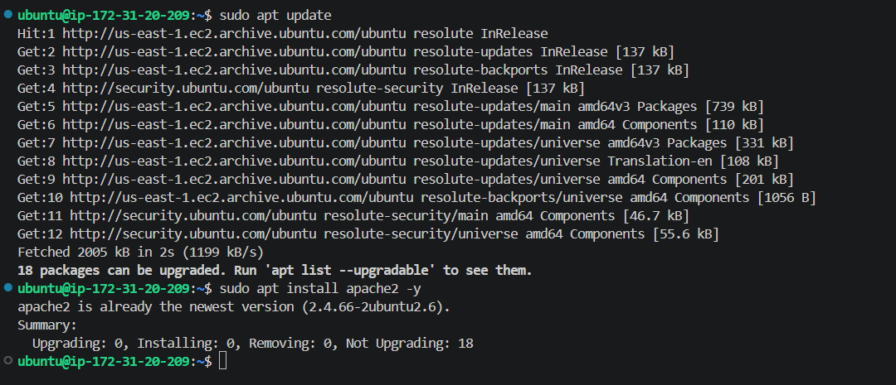

### Paso 2: Creación de directorios y archivos necesarios
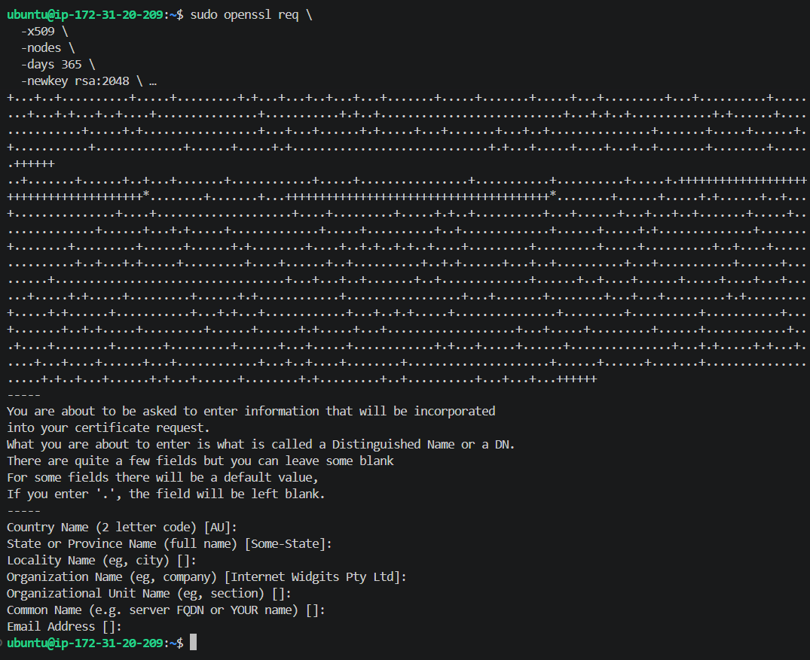

### Paso 3: Configuración del Virtual Host en Apache
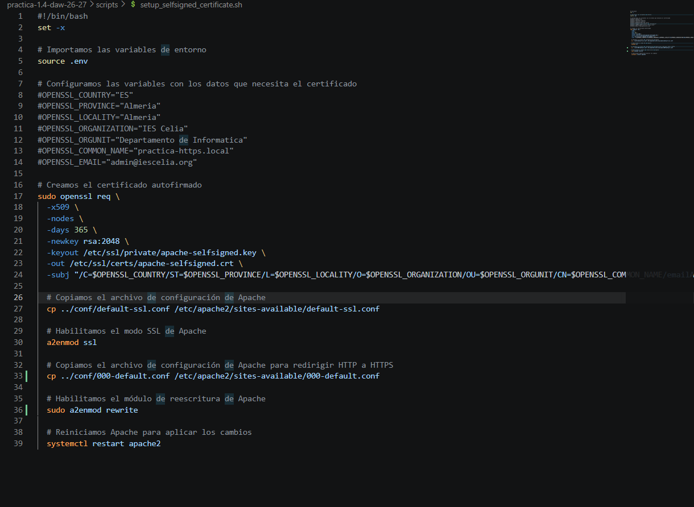

### Pasos 4 y 5: Activación del módulo SSL y reinicio de Apache
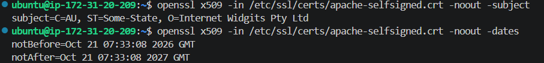

### Paso 6: Comprobación del protocolo HTTPS en el navegador

Al intentar acceder, el navegador detecta que el certificado es autofirmado y muestra la advertencia de seguridad de la entidad emisora:
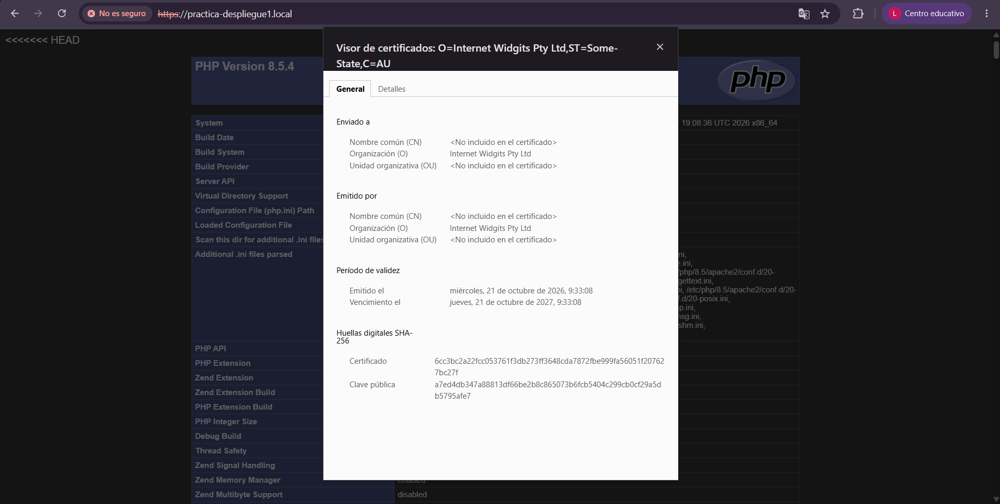

A continuación, se detalla el proceso para omitir la advertencia paso a paso:

1. **Pantalla inicial del error:**
   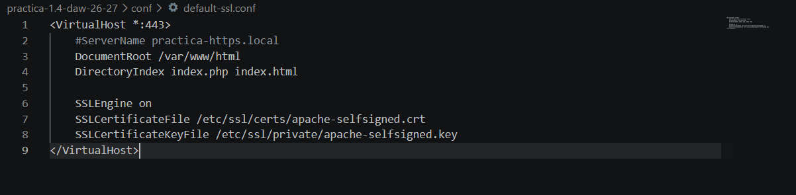

2. **Hacer clic en Opciones Avanzadas:**
   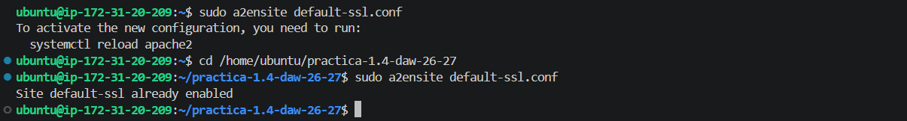

3. **Confirmar el acceso al sitio no seguro:**
   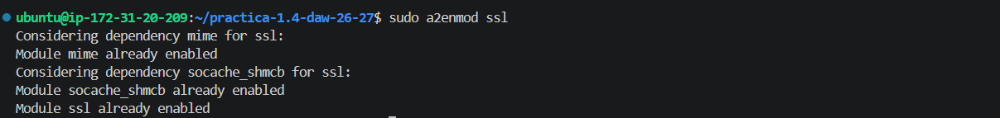

4. **Carga correcta del sitio web:**
   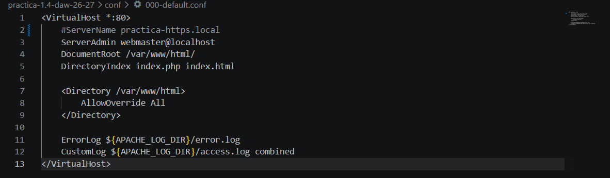

5. **Verificación final del cifrado en el navegador:**
   

Luego se añade la dirección IPv4 pública de la instancia al archivo "hosts":
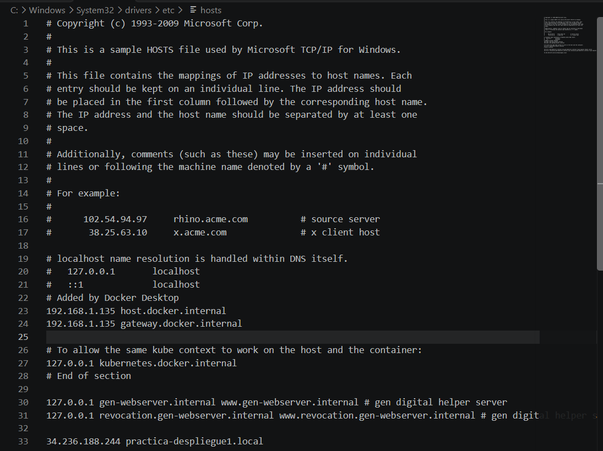

Y por último, se accede a la ip elástica en el navegador:
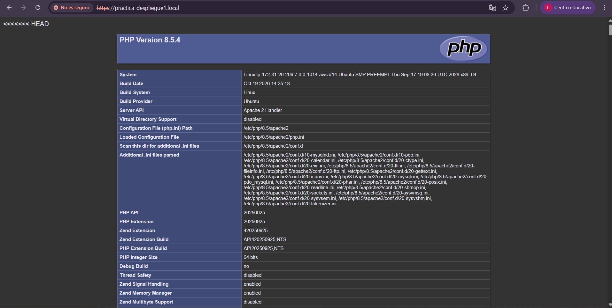